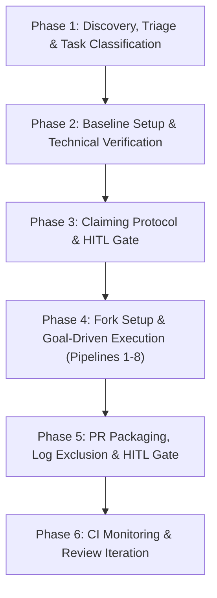

# GitHub Bounty Hunter Skill

End-to-end workflow orchestrating the complete lifecycle of paid open-source contributions across GitHub, Algora, and Polar. Issue resolution operates autonomously via the `goal-driven` execution engine across all standard pipelines (Pipelines 1 through 8) inheriting from `00-orchestrator`. Auto-approves intermediate design and planning gates while preserving mandatory human-in-the-loop gates for public claim comments and pull requests. Governed by operational parameters in [config.json](config.json) and guides in [references/](references/).

## Language Protocol
- All internal analysis, technical documentation, commit messages, and PR descriptions MUST be written in English.
- User communication, interim status updates, and session handoffs should match the user's preferred language.

## Trigger
Activates when the user requests finding, assessing, solving, or claiming paid GitHub issues, or when keywords appear: `bounty-hunter`, `github-bounty`, `paid-contribution`, `algora`, `polar`, `hunt-bounty`, `solve-bounty`.

## Workflow



### Phase 1: Discovery, Triage & Task Classification
**Objective**: Query bounty platforms, filter viable unassigned tasks, verify escrow funding status, and classify task category.

1. Ingest operational parameters from [config.json](config.json) (`search_policy`, `eligibility_policy`, `runtime_policy`).
2. Query candidate issues across platforms using `scripts/search_bounties.py` or platform APIs per [references/discovery-platforms.md](references/discovery-platforms.md):
   - Enforce criteria: `state:open`, `no:assignee`, active bounty label (`bounty`, `algora`, `polar`), matching target language (`typescript`, `python`, `go`, `rust`).
   - Filter by minimum reward (`min_reward_usd`).
3. Audit issue health against the Triage Matrix in [references/discovery-platforms.md](references/discovery-platforms.md):
   - Reject stale issues (> `max_issue_age_days` with high unresolved comments > 20) or contested issues with active PRs/assignees.
   - Verify escrow status: confirm bounty is actively funded in escrow (not an unbacked pledge).
   - Verify expiration: ensure bounty has sufficient active window (> 7 days) before expiry.
4. Classify task type into 1 of 3 functional groups:
   - **Feature / Refactor / Enhancement**: New capabilities, API endpoints, module refactoring, performance adaptations.
   - **Bug Fix**: Defect, crash, regression, unexpected error behavior.
   - **Documentation**: README, developer guides, API specifications, docsite updates.
5. Output a ranked table of viable bounty candidates with issue number, repository, reward, platform, and scope assessment.

### Phase 2: Baseline Setup & Technical Verification
**Objective**: Audit repository dependencies, isolate the environment, build the project, and establish verification proof before touching production code.

1. Set up an isolated workspace directory specified in `config.json` (`scratch/bounties/<repo-name>`).
2. Perform security pre-flight per `security_policy`:
   - Inspect package manifests (`package.json`, `setup.py`, `Cargo.toml`) for suspicious lifecycle scripts (`preinstall`, `postinstall`).
   - Restrict execution to allowed package managers (`allowed_package_managers`).
3. Parse `CONTRIBUTING.md` and `README.md` to identify runtime versions and setup instructions.
4. Install dependencies in isolation and run the baseline test suite. Verify existing tests pass before proceeding:
   - If baseline tests fail, resolve environment incompatibilities or abandon the issue to prevent false positives.
5. Establish pre-work verification baseline based on task category:
   - **For Bug Fixes**: Author an isolated reproduction script/test confirming failure (Red proof). Capture CLI error output.
   - **For Features / Refactoring**: Author initial acceptance test criteria and boundary assertion stubs asserting desired behavior.
   - **For Documentation**: Identify source code modules, public interfaces, or CLI commands to be documented.

### Phase 3: Claiming Protocol & Human-in-the-Loop (HITL) Gate
**Objective**: Formulate a professional technical proposal and enforce a mandatory human approval barrier before publishing any public comment.

1. Analyze codebase requirements and formulate a tailored claim proposal per [references/claiming-etiquette.md](references/claiming-etiquette.md):
   - **For Bug Fixes**: State confirmed local reproduction, identified root cause, and concrete 3-step surgical fix plan.
   - **For Features / Refactoring**: State architectural approach, affected modules, TDD test strategy, and non-breaking contract guarantees.
   - **For Documentation**: State target documentation structure, affected sections, and clarity objectives.
   - Attach platform-specific commands if applicable (`/attempt` for Algora).
2. **MANDATORY HITL GATE**: Present the drafted comment to the human operator for review and approval.
   - Halt execution. Under NO circumstances post public comments, bot commands, or claim requests without explicit human sign-off.
3. Upon operator approval, submit the comment to GitHub. Wait for maintainer assignment or proceed according to repository policy.

### Phase 4: Fork Setup & Autonomous Goal-Driven Execution (Pipelines 1–8)
**Objective**: Configure git remotes and execute the full implementation lifecycle autonomously using skill `goal-driven`, routing across Pipelines 1–8.

1. Configure fork workflow per [references/pr-template-guide.md](references/pr-template-guide.md) and `git_policy`:
   - Fork upstream repository (`gh repo fork <owner>/<repo> --clone=false`).
   - Set `origin` to the contributor fork and `upstream` to the authoritative source repository.
   - Create a dedicated branch cut from the latest upstream default branch following `git_policy` branch prefixes:
     - Bug fixes: `fix/bounty-issue-<id>-<slug>`
     - Features/enhancements: `feat/bounty-issue-<id>-<slug>`
     - Documentation: `docs/bounty-issue-<id>-<slug>`
2. Dispatch task execution to autonomous engine skill `goal-driven` using the mapped pipeline:
   - **Group A: Feature / Enhancement / Refactoring (Pipelines 1, 2, 3)**:
     - **Pipeline 1 (Small Implementation)**: `goal-driven` runs `[06-test Red -> 03-implement Green+Refactor]* -> 07-review`.
     - **Pipeline 2 (Ambiguous Implementation)**: `goal-driven` runs `01-brainstorm` (auto-answers clarifying questions with logged rationales) -> `[06-test -> 03-implement]* -> 07-review`.
     - **Pipeline 3 (Complex / Risky Implementation)**: `goal-driven` runs `01-brainstorm` -> `02-plan` (auto-approves wave plan) -> [Parallel waves: `06-test` Red -> `03-implement` Green] -> `07-review`.
   - **Group B: Bug Resolution (Pipelines 4a, 4b, 5, 6)**:
     - **Pipeline 4a (Unknown bug, simple)**: `goal-driven` runs `04-bugfinder` -> `06-test` (Red) -> `05-fix` (Green + Refactor) -> `07-review`.
     - **Pipeline 4b (Unknown bug, complex/multi-module)**: `goal-driven` runs `04-bugfinder` -> `02-plan` -> [Parallel waves: `06-test` Red -> `05-fix` Green] -> `07-review`.
     - **Pipeline 5 (Known bug, simple)**: `goal-driven` runs `06-test` (Red) -> `05-fix` (Green + Refactor) -> `07-review`.
     - **Pipeline 6 (Known bug, complex/architectural)**: `goal-driven` runs `02-plan` -> [Parallel waves: `06-test` Red -> `05-fix` Green] -> `07-review`.
   - **Group C: Documentation (Pipelines 7, 8)**:
     - **Pipeline 7 (Documentation follow-up)**: `goal-driven` runs `08-readme-management` after code changes -> review.
     - **Pipeline 8 (Documentation-only task)**: `goal-driven` runs `08-readme-management` directly -> sanity review.
3. **Mandatory Pipeline-Skill Binding Invariants**:
   - For all features, refactoring, and enhancements (Pipelines 1–3), implementation is performed by `03-implement`.
   - For all bug fixes and defect remediations (Pipelines 4a, 4b, 5, 6), code fixes are STRICTLY performed by `05-fix`. Dispatching or loading `03-implement` for bug fixes is a critical pipeline violation.
   - For all documentation tasks (Pipelines 7–8), authoring is performed by `08-readme-management`.
   - All code pipelines must verify tests Green and receive a decisive PASS from `07-review` before Phase 4 completion.
4. Run project linter and formatter (`eslint`, `prettier`, `ruff`, `cargo fmt`) to ensure strict compliance.
5. Re-run the full test suite to guarantee zero regression across existing functionality.
6. Commit changes adhering to `git_policy`:
   - Follow prefix format (`fix: `, `feat: `, or `docs: `).
   - If `git_policy.require_dco_signoff` is enabled, apply `-s` flag (`Signed-off-by:`).

### Phase 5: PR Packaging, Harness Log Exclusion & Submission
**Objective**: Package changes into a compliant Pull Request while strictly ensuring no harness execution logs are committed or pushed.

1. **Harness Log Exclusion Gate (Mandatory)**:
   - Execution logs generated under `docs/harness-logs/` by `goal-driven` or `00-orchestrator` are strictly local to the runtime harness.
   - Configure local git ignore: append `docs/harness-logs/` to `.git/info/exclude`.
   - Stage modified code, test, and documentation files selectively (`git add <file1> <file2>`). NEVER run `git add .` or `git add -A`.
   - Verify exclusion: execute `git diff --name-only upstream/main...HEAD` and confirm zero files matching `docs/harness-logs/` or `git_policy.excluded_paths_from_commit` exist in the commit history.
2. Generate a comprehensive PR description following [references/pr-template-guide.md](references/pr-template-guide.md):
   - Include mandatory closing keyword: `Fixes #<issue_id>` or `Closes #<issue_id>`.
   - Embed test execution output, before/after evidence, and DCO confirmation.
3. **MANDATORY HITL GATE**: Present the PR title, body, and git diff summary to the operator.
4. Upon operator approval, push the branch to `origin` and open the Pull Request targeting upstream via GitHub CLI (`gh pr create --repo <owner>/<repo>`).

### Phase 6: CI Monitoring & Review Iteration
**Objective**: Track continuous integration checks, remediate any build/lint regressions, address maintainer feedback, and verify payout triggering.

1. Monitor GitHub Actions status checks (`gh pr checks --watch`).
2. If CI fails:
   - Retrieve failure logs immediately, reproduce the specific CI failure locally, and push an atomic fix commit using `05-fix` (for bugs) or `03-implement` (for features) with DCO sign-off.
3. When maintainers submit review comments:
   - Provide prompt, professional responses.
   - Implement requested adjustments directly on the branch, re-verify tests, and notify the maintainer.
4. Once merged, verify that the bounty platform bot registers resolution and triggers payout processing.

## Token & Configuration Setup
To enable automated searches and operations, configure credentials in your environment:
- `GITHUB_TOKEN`: GitHub Personal Access Token (scopes: `repo`, `read:org`) or authenticated `gh auth login`.
- **Bounty Platform Verification**: For Algora, payouts are claimed per-reward via the automated bot link posted upon PR merge. For Polar, connect your GitHub account at `https://polar.sh` to configure Stripe Express payouts under Finance.

## Output Format
Deliver structured execution reports at each milestone:
```markdown
### Bounty Hunter Milestone Report: [Stage Name]
- **Target Issue**: #[id] - [Title] ([owner/repo])
- **Task Category**: [Feature | Bug Fix | Refactoring | Documentation]
- **Bounty Platform**: [Algora | Polar | Native] | **Reward**: [$Amount] (Escrow: Funded)
- **Autonomous Engine**: goal-driven | **Underlying Pipeline**: [Pipeline 1-8]
- **Status**: [Triage | Repro/Setup | Claimed | Implementing | PR Open | Merged]
- **Verification Proof**: [Summary of test verification / regression proof]
- **PR Link**: [URL] (if opened)
- **Pending Actions**: [Human confirmation | Maintainer review | CI pending]
```

## Don'ts
- **Never use absolute paths when referencing skills `goal-driven`, `00-orchestrator`, or `01-08`**: Always reference them by their abstract skill names or configure them via `config.json` to preserve harness independence.
- **Never use `03-implement` for bug fixes**: All defect resolution code changes must strictly adhere to `05-fix` within Pipelines 4a, 4b, 5, or 6.
- **Never use `05-fix` for new feature additions**: New capabilities and refactoring without existing bugs belong strictly to `03-implement` within Pipelines 1, 2, or 3.
- **Never commit or push harness logs**: Files in `docs/harness-logs/` must never be staged, committed, or pushed to any remote repository.
- **Never bypass the HITL Approval Gate**: Despite autonomous execution in Phase 4 via `goal-driven`, the agent must NEVER post public claim comments (Phase 3) or submit public PRs (Phase 5) without explicit human confirmation.
- **Never submit unsolicited, unverified PRs**: Blind PRs without local reproduction or test verification violate open-source etiquette.
- **Never spam generic claim comments**: Messages like "Can I take this?" without technical evidence are strictly prohibited.
- **Never expand scope**: Do not fix unrelated issues, refactor working modules, or touch dependency locks unless strictly required.
- **Never commit credentials**: Never push `.env` files, API keys, or private tokens to remote repositories.
- **Never push directly to upstream**: Always work through an authorized fork and submit pull requests to upstream.
- **Never omit DCO sign-off when mandated**: Always apply `git commit -s` when repository policy requires signed commits.

## Quality Checklist
- [ ] Issue verified as open, unassigned, with active funded escrow and valid expiration in Phase 1?
- [ ] Task categorized accurately (Feature / Bug Fix / Documentation) and mapped to appropriate pipeline (1–8)?
- [ ] Dependency lifecycle scripts audited and environment isolated before installing packages?
- [ ] Baseline test suite passed and Red proof / acceptance criteria established in Phase 2?
- [ ] Mandatory HITL approval received before posting claim comment or bot command?
- [ ] Git fork configured with `origin` and `upstream` remotes properly separated?
- [ ] Issue resolution executed autonomously via `goal-driven` using correct skill binding (`03-implement` for features, `05-fix` for bugs, `08-readme-management` for docs)?
- [ ] Intermediate plan/design gates auto-approved with logged rationales by `goal-driven` without user pauses?
- [ ] Skills `goal-driven`, `00-orchestrator`, and `01-08` referenced without absolute paths?
- [ ] All files in `docs/harness-logs/` verified excluded and completely absent from git diff?
- [ ] PR description contains required closing keyword (`Fixes #<id>`) and test evidence?
- [ ] Mandatory HITL approval received before opening public PR targeting upstream?
- [ ] CI build and tests verified Green after PR submission?
