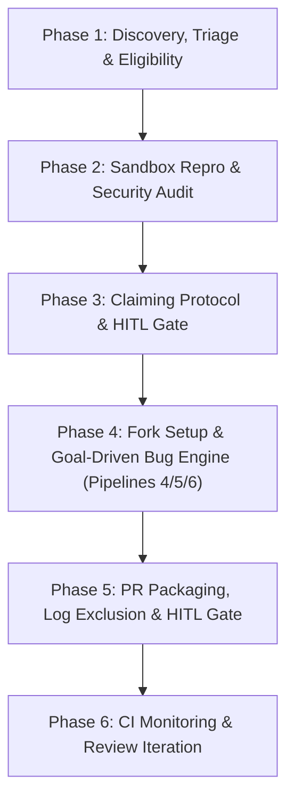

# GitHub Bounty Hunter Skill

End-to-end workflow orchestrating the complete lifecycle of paid open-source contributions across GitHub, Algora, and Polar. Issue resolution operates autonomously via the `goal-driven` execution engine, executing `00-orchestrator` bug-fixing pipelines (Pipelines 4a, 4b, 5, or 6) with auto-approved intermediate planning gates while preserving human-in-the-loop gates for public claim comments and pull requests. Governed by operational parameters in [config.json](config.json) and guides in [references/](references/).

## Language Protocol
- All internal analysis, technical documentation, commit messages, and PR descriptions MUST be written in English.
- User communication, interim status updates, and session handoffs should match the user's preferred language.

## Trigger
Activates when the user requests finding, assessing, solving, or claiming paid GitHub issues, or when keywords appear: `bounty-hunter`, `github-bounty`, `paid-contribution`, `algora`, `polar`, `hunt-bounty`, `solve-bounty`.

## Workflow



### Phase 1: Discovery, Triage & Eligibility Verification
**Objective**: Query bounty platforms, filter viable unassigned tasks, audit escrow funding status, and verify payout eligibility.

1. Ingest operational parameters from [config.json](config.json) (`search_policy`, `eligibility_policy`, `runtime_policy`).
2. Query candidate issues across platforms using `scripts/search_bounties.py` or platform APIs per [references/discovery-platforms.md](references/discovery-platforms.md):
   - Enforce criteria: `state:open`, `no:assignee`, active bounty label (`bounty`, `algora`, `polar`), matching target language (`typescript`, `python`, `go`, `rust`).
   - Filter by minimum reward (`min_reward_usd`).
3. Audit issue health against the Triage Matrix in [references/discovery-platforms.md](references/discovery-platforms.md):
   - Reject issues older than `max_issue_age_days` with high unresolved comment volume (> 20 comments).
   - Reject issues where another contributor was already assigned or has an active PR open.
   - Verify escrow status: confirm bounty is actively funded in escrow (not an unbacked pledge).
   - Verify expiration: ensure bounty has sufficient active window (> 7 days) before expiry.
4. Output a ranked table of viable bounty candidates with issue number, repository, reward, platform, and scope assessment.

### Phase 2: Local Reproduction & Security Isolation
**Objective**: Audit repository dependencies, isolate the environment, build the project, and author an independent reproduction script/test confirming the issue exists.

1. Set up an isolated workspace directory specified in `config.json` (`scratch/bounties/<repo-name>`).
2. Perform security pre-flight per `security_policy`:
   - Inspect package manifests (`package.json`, `setup.py`, `Cargo.toml`) for suspicious lifecycle scripts (`preinstall`, `postinstall`).
   - Restrict execution to allowed package managers (`allowed_package_managers`).
3. Parse `CONTRIBUTING.md` and `README.md` to identify runtime versions and setup instructions.
4. Install dependencies in isolation and run the baseline test suite. Verify existing tests pass before touching any code:
   - If baseline tests fail, resolve environment incompatibilities or abandon the issue to prevent false positives.
5. Create an isolated reproduction script or test case recreating the exact failure scenario described in the issue.
6. Execute the reproduction script and verify failure (Red proof). Capture CLI error output as baseline evidence.

### Phase 3: Claiming Protocol & Human-in-the-Loop (HITL) Gate
**Objective**: Formulate a professional root-cause proposal and enforce a mandatory human approval barrier before publishing any public comment.

1. Perform root cause analysis on the codebase to identify affected files and functions.
2. Confirm pre-claim prerequisites: local Red proof confirmed, funded escrow verified, payout route active.
3. Draft a structured proposal comment adhering to [references/claiming-etiquette.md](references/claiming-etiquette.md):
   - State confirmed local reproduction, identified root cause, and concrete 3-step fix plan aligned with the autonomous bug execution model.
   - Attach platform-specific commands if applicable (`/attempt` for Algora).
4. **MANDATORY HITL GATE**: Present the drafted comment to the human operator for review and approval.
   - Halt execution. Under NO circumstances post public comments, bot commands, or claim requests without explicit human sign-off.
5. Upon operator approval, submit the comment to GitHub. Wait for maintainer assignment or proceed according to repository policy.

### Phase 4: Fork Setup & Autonomous Bug Resolution via Goal-Driven Engine (Pipelines 4/5/6)
**Objective**: Configure git remotes and resolve the issue autonomously using skill `goal-driven`, which drives `00-orchestrator` bug pipelines with auto-approved intermediate planning gates.

1. Configure fork workflow per [references/pr-template-guide.md](references/pr-template-guide.md) and `git_policy`:
   - Fork upstream repository (`gh repo fork <owner>/<repo> --clone=false`).
   - Set `origin` to the contributor fork and `upstream` to the authoritative source repository.
   - Create a dedicated branch cut from the latest upstream default branch (`fix/bounty-issue-<id>-<slug>`).
2. Dispatch issue resolution to autonomous engine skill `goal-driven` using the appropriate pipeline:
   - **Pipeline 4a (Unknown-cause bug, simple)**:
     `goal-driven` runs `04-bugfinder` -> `06-test` (Red) -> `05-fix` (Green + Refactor) -> `07-review`.
   - **Pipeline 4b (Unknown-cause bug, complex/multi-module)**:
     `goal-driven` runs `04-bugfinder` -> `02-plan` (auto-approves plan with logged rationale) -> [Parallel waves: `06-test` Red -> `05-fix` Green] -> `07-review`.
   - **Pipeline 5 (Known-cause bug, simple)**:
     `goal-driven` runs `06-test` (Red) -> `05-fix` (Green + Refactor) -> `07-review`.
   - **Pipeline 6 (Known-cause bug, complex/architectural)**:
     `goal-driven` runs `02-plan` (auto-approves plan with logged rationale) -> [Parallel waves: `06-test` Red -> `05-fix` Green] -> `07-review`.
3. **Autonomous Execution Invariants**:
   - Intermediate approval gates (brainstorm, planning, wave barriers) are auto-approved by `goal-driven` with documented rationales in the execution log, avoiding interactive pauses for the user.
   - **Green + Refactor skill is STRICTLY `05-fix`**: Using `03-implement` for bug fixes remains strictly prohibited.
   - Phase 4 completes only when `07-review` returns `PASS` and `<!-- GOAL_COMPLETE -->` is emitted.
4. Run project linter and formatter (`eslint`, `prettier`, `ruff`, `cargo fmt`) to ensure strict compliance.
5. Re-run the full test suite to guarantee zero regression across existing functionality.
6. Commit changes adhering to `git_policy`:
   - Follow prefix format (`fix: resolve #<id> <description>`).
   - If `git_policy.require_dco_signoff` is enabled, apply `-s` flag (`Signed-off-by:`).

### Phase 5: PR Packaging, Harness Log Exclusion & Submission
**Objective**: Package changes into a compliant Pull Request while strictly ensuring no harness execution logs are committed or pushed.

1. **Harness Log Exclusion Gate (Mandatory)**:
   - Execution logs generated under `docs/harness-logs/` by `goal-driven` or `00-orchestrator` are strictly local to the runtime harness.
   - Configure local git ignore: append `docs/harness-logs/` to `.git/info/exclude`.
   - Stage modified code and test files selectively (`git add <file1> <file2>`). NEVER run `git add .` or `git add -A`.
   - Verify exclusion: execute `git diff --name-only upstream/main...HEAD` and confirm zero files matching `docs/harness-logs/` or `git_policy.excluded_paths_from_commit` exist in the commit history.
2. Generate a comprehensive PR description following [references/pr-template-guide.md](references/pr-template-guide.md):
   - Include mandatory closing keyword: `Fixes #<issue_id>` or `Closes #<issue_id>`.
   - Embed test execution output, before/after evidence, and DCO confirmation.
3. **MANDATORY HITL GATE**: Present the PR title, body, and git diff summary to the operator.
4. Upon operator approval, push the branch to `origin` and open the Pull Request targeting upstream via GitHub CLI (`gh pr create --repo <owner>/<repo>`).

### Phase 6: CI Monitoring & Review Iteration
**Objective**: Track continuous integration checks, remediate any build/lint regressions, address maintainer feedback, and verify payout triggering.

1. Monitor GitHub Actions status checks (`gh pr checks --watch`).
2. If CI fails:
   - Retrieve failure logs immediately, reproduce the specific CI failure locally, and push an atomic fix commit using `05-fix` with DCO sign-off.
3. When maintainers submit review comments:
   - Provide prompt, professional responses.
   - Implement requested adjustments directly on the branch via `05-fix`, re-verify tests, and notify the maintainer.
4. Once merged, verify that the bounty platform bot registers resolution and triggers payout processing.

## Token & Configuration Setup
To enable automated searches and operations, configure credentials in your environment:
- `GITHUB_TOKEN`: GitHub Personal Access Token (scopes: `repo`, `read:org`) to prevent API rate limiting.
- **Bounty Platform Accounts**: Ensure the GitHub account is linked to [console.algora.io](https://console.algora.io) and [polar.sh](https://polar.sh) with a verified Stripe Express payout account.

## Output Format
Deliver structured execution reports at each milestone:
```markdown
### Bounty Hunter Milestone Report: [Stage Name]
- **Target Issue**: #[id] - [Title] ([owner/repo])
- **Bounty Platform**: [Algora | Polar | Native] | **Reward**: [$Amount] (Escrow: Funded)
- **Autonomous Engine**: goal-driven | **Underlying Pipeline**: [Pipeline 4a | Pipeline 4b | Pipeline 5 | Pipeline 6]
- **Status**: [Triage | Repro | Claimed | Implementing | PR Open | Merged]
- **Reproduction Proof**: [Summary of test verification]
- **PR Link**: [URL] (if opened)
- **Pending Actions**: [Human confirmation | Maintainer review | CI pending]
```

## Don'ts
- **Never use absolute paths when referencing skills `goal-driven` or `00-orchestrator`**: Always reference them by their abstract skill names or configure them via `config.json` to preserve harness independence.
- **Never use `03-implement` for bug fixes**: All defect resolution code changes must strictly adhere to `05-fix` within the bug pipelines driven by `goal-driven`.
- **Never commit or push harness logs**: Files in `docs/harness-logs/` must never be staged, committed, or pushed to any remote repository.
- **Never bypass the HITL Approval Gate**: Despite autonomous execution in Phase 4 via `goal-driven`, the agent must NEVER post public claim comments (Phase 3) or submit public PRs (Phase 5) without explicit human confirmation.
- **Never submit unsolicited, unverified PRs**: Blind PRs without local reproduction violate open-source etiquette and risk account suspension.
- **Never spam generic claim comments**: Messages like "Can I take this?" without technical evidence are strictly prohibited.
- **Never expand scope**: Do not fix unrelated issues, refactor working modules, or touch dependency locks unless strictly required.
- **Never commit credentials**: Never push `.env` files, API keys, or private tokens to remote repositories.
- **Never push directly to upstream**: Always work through an authorized fork and submit pull requests to upstream.
- **Never omit DCO sign-off when mandated**: Always apply `git commit -s` when repository policy requires signed commits.
- **Never work on unbacked pledges blindly**: Always verify funded escrow status before investing significant implementation effort.

## Quality Checklist
- [ ] Issue verified as open, unassigned, with active funded escrow and valid expiration in Phase 1?
- [ ] Dependency lifecycle scripts audited and environment isolated before installing packages?
- [ ] Local dev environment built and baseline test suite passed before making changes?
- [ ] Standalone reproduction script/test confirmed Red before applying fix?
- [ ] Mandatory HITL approval received before posting claim comment or bot command?
- [ ] Git fork configured with `origin` and `upstream` remotes properly separated?
- [ ] Issue resolution executed autonomously via `goal-driven` following `00-orchestrator` Pipeline 4a, 4b, 5, or 6?
- [ ] Intermediate plan/design gates auto-approved with logged rationales by `goal-driven` without user pauses?
- [ ] Green + Refactor phase strictly executed via `05-fix` (never `03-implement`)?
- [ ] Skills `goal-driven` and `00-orchestrator` referenced without absolute paths?
- [ ] All files in `docs/harness-logs/` verified excluded and completely absent from git diff?
- [ ] PR description contains required closing keyword (`Fixes #<id>`) and test evidence?
- [ ] Mandatory HITL approval received before opening public PR targeting upstream?
- [ ] CI build and tests verified Green after PR submission?
